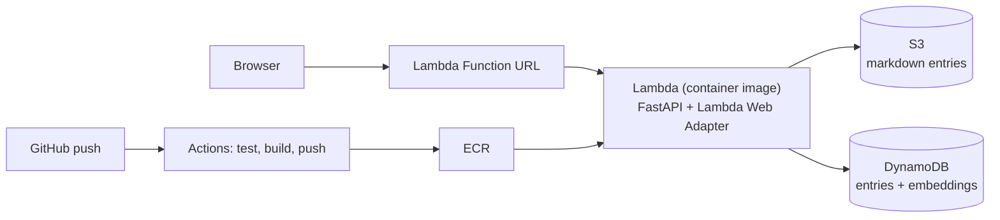

# Searchable KB

September 2026

Python · FastAPI · fastembed · NumPy · Docker · AWS Lambda · S3 · DynamoDB · GitHub Actions

A semantic search service for IT support knowledge bases. Knowledge bases usually already contain the answer, but people can't find it, because keyword search only works if you type the same words the author used. Someone types "can't log in", but the entry is titled "Account Lockout Remediation via Identity Management Portal". Searchable KB turns every entry into an embedding with a sentence-embedding model and ranks entries by meaning, so describing the problem in plain language finds the entry that fixes it. It runs as a container on AWS Lambda and redeploys automatically on every push to `main`.

**[Try it live → Searchable KB on AWS Lambda](https://wtzpij76fw4cfysmikyhfg3kti0vmnvv.lambda-url.us-west-2.on.aws/)**

> The service runs on Lambda, which shuts down idle containers. If nobody has searched in a while, the first search can take a few seconds while the container starts and loads the model. After that, searches are fast.

## What you get

- **Search by meaning, not keywords.** Type the problem the way a user would say it, like "nothing comes out of the printer" or "I clicked a sketchy link", and get the entry that fixes it, even when it shares none of your words.
- **The top three matches, with sources.** Each result shows its title, tags, a similarity score and the file it came from, so you can check where the answer came from. Expand any result to read the full entry.
- **A plain HTTP API.** `GET /api/search?q=...&k=3` returns the best k matches (up to 10) as JSON, along with how long the search took.
- **Re-indexing in one request.** `POST /api/ingest` reads every markdown entry, embeds it and rebuilds the index. In production it requires a secret token, so not just anyone with the URL can trigger it.
- **15 sample entries** in [`kb/`](kb/), covering problems like account lockouts, VPN issues, MFA re-enrollment and print queues. They're fictional, written for this project.

## How to use it

1. **Open the [live site](https://wtzpij76fw4cfysmikyhfg3kti0vmnvv.lambda-url.us-west-2.on.aws/).**
2. **Describe a problem in your own words,** or click one of the example searches under the search box.
3. **Read the results.** The closest match is first. Click **Show entry** to read the full fix.

Or call the API directly:

```bash
curl "https://wtzpij76fw4cfysmikyhfg3kti0vmnvv.lambda-url.us-west-2.on.aws/api/search?q=got+a+new+phone+and+cant+approve+sign+ins"
```

## How it's built

| Piece | Built with |
|---|---|
| API and web page | FastAPI, served by uvicorn |
| Embeddings | fastembed (ONNX Runtime) with `BAAI/bge-small-en-v1.5` |
| Ranking | Cosine similarity over a NumPy matrix |
| Hosting | Docker image on AWS Lambda (arm64), with a public Function URL |
| Storage | Source entries in S3, entries and embeddings in DynamoDB |
| Deployment | GitHub Actions: test, build, push to ECR, update Lambda |



Ingest embeds each entry's title and body together, because the title carries the official terminology and the body carries the symptoms people actually describe. Search embeds the query with the same model and ranks every entry by cosine similarity. Storage is chosen by an environment variable: locally it's files on disk and a JSON index, and on AWS it's S3 and DynamoDB. Everything else runs the same code.

## Design decisions

- **fastembed instead of sentence-transformers.** It avoids PyTorch, which keeps the image around 700 MB instead of several GB and makes Lambda cold starts shorter.
- **Model baked into the image.** Lambda can only write to `/tmp`, and downloading the model on every cold start would add seconds. The app loads it with `local_files_only`.
- **Lambda Web Adapter instead of a Lambda-specific handler.** The container is a normal uvicorn web server, so the same image runs on a laptop and in Lambda.
- **Lambda and a Function URL.** Traffic is occasional, so paying per request beats paying hourly for a load balancer or an always-on container.
- **Brute-force cosine similarity.** With a few dozen entries, one matrix multiply is instant and needs no extra infrastructure.
- **OIDC for GitHub Actions.** The workflow assumes an AWS role that only this repo's `main` branch can use, so no long-lived AWS keys are stored in GitHub.

## Limitations and what I'd change at scale

- **Semantic search is overkill at this size.** With 15 entries, keyword search plus a synonym list would do. Semantic search starts to pay off at thousands of entries written by many different authors.
- **Pure vector search misses some obvious matches.** "laptop won't connect to wifi" doesn't surface the 802.1X wireless entry, because that entry says "wireless" and never "Wi-Fi", and a small model doesn't strongly link the two. Hybrid ranking (a BM25 keyword score plus the vector score) would fix this kind of miss.
- **One vector per entry.** Long entries would need to be split into chunks, so a match on one section isn't diluted by the rest of the entry.
- **Full scan of DynamoDB on cold start.** Fine for hundreds of entries. Beyond that, the vectors belong in a vector index such as OpenSearch k-NN or pgvector.
- **Stale index across Lambda instances.** Each warm instance caches the index in memory, so after an ingest, other instances serve old results until they're recycled. A version stamp checked on each request would fix it.
- **The ingest token lives in an environment variable.** That's fine for a demo. A production setup would read it from SSM Parameter Store or Secrets Manager.

<details>
<summary><strong>Running Searchable KB yourself</strong></summary>

**Locally** (runs on port 8000)

```bash
python3 -m venv .venv && source .venv/bin/activate
pip install -r requirements.txt -r requirements-dev.txt
pytest -q
uvicorn app.main:app --reload --port 8000
```

In a second terminal, build the index and open the page:

```bash
curl -X POST localhost:8000/api/ingest
open http://localhost:8000
```

**In Docker**, with the filesystem locked down the way Lambda's is:

```bash
docker build -t searchable-kb:local .
docker run --rm -p 8080:8080 --read-only --tmpfs /tmp searchable-kb:local
curl -X POST localhost:8080/api/ingest
```

**On AWS:** every step, including the IAM roles, CI/CD setup and teardown, is in [DEPLOY.md](DEPLOY.md).

</details>
